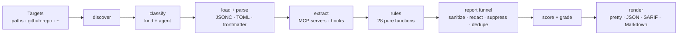

# How bekci works

This document is for contributors and for anyone deciding whether to trust the tool. It covers the pipeline, the threat model bekci is built against, and the design decisions behind both.

## Pipeline



| Stage | File | What it does |
| --- | --- | --- |
| Discover | `src/discover.ts` | Walks the project paths and a fixed list of user-level locations. Only file *names* are collected at this stage, so large trees stay cheap. Skill directories are then walked in full for scripts, reference docs and binaries, and files reached indirectly are added: paths referenced from `plugin.json` and `@imports` in `CLAUDE.md` (up to five hops). |
| Classify | `classify()` | Maps a path to a **kind** (`instructions`, `skill`, `subagent`, `command`, `reference`, `script`, `config`, `binary`) and an **agent** (Claude Code, Codex, …). Anything unrecognised is ignored: bekci never reads your source code. |
| Load and parse | `load()`, `src/parsers/` | Reads text (2 MB limit; larger files become BK207 findings rather than being skipped). Parses JSON with comments, TOML and YAML frontmatter with built-in, dependency-free parsers; files that fail to parse become BK208 findings. |
| Extract | `extractServers()`, `extractHooks()` | Normalises MCP server definitions from every supported format (`mcpServers`, `mcp_servers`, VS Code `servers`, per-project blocks in `~/.claude.json`, `plugin.json`) and hook commands from every event shape into one model, with line numbers. Servers launched through `cmd /c` or `sh -c` are unwrapped so the supply-chain rules see the real package. |
| Rules | `src/rules/` | Each rule is a pure function `run(ctx, report)`. Rules never touch the file system or the network. |
| Report funnel | `src/scan.ts` | The only path from a rule to the user. It applies severity filters, path globs and inline suppressions, strips control characters, redacts secrets and removes duplicates. |
| Score | `grade_()` | Turns findings into a 0–100 score and an A–F grade (see below). |
| Render | `src/report/` | Pretty terminal output, JSON, SARIF 2.1.0 for code scanning, Markdown for PR comments and job summaries. One scan can write several formats (`-o` is repeatable). |

### Text units

Most content rules do not care whether text came from a Markdown file, a bundled script, an MCP server's command line or a hook. `executableUnits()` turns all of them into **text units**: a string, the file it belongs to, and either real offsets or a fixed line (for strings extracted from JSON/TOML). A rule such as BK005 (`curl | sh`) is therefore written once and covers skills, scripts, hooks and server definitions.

### Correlation

Some risks only exist in combination:

- **BK010** reports a file (or a hook, or a server definition) that both reads a credential store and makes a network request. Correlation is deliberately per file, and in prose the two statements must be within 15 lines of each other: correlating across a whole skill directory or a long document produced false positives in large, legitimate skills such as `anthropics/skills`.
- **BK301** groups enabled MCP servers per agent (global servers plus each project's servers) and reports when the group covers all three legs of the lethal trifecta: private data, untrusted content, and an exfiltration channel.

## Threat model

bekci reads files written by people who may want to attack you, or who want to get their skill past your review. **Every scanned file is hostile input.**

| Attack on the scanner | Defence | Test |
| --- | --- | --- |
| Hang the scan with a pathological line (ReDoS) | Repetition in every content regex is bounded; no nested ambiguous quantifiers; line lookups are O(log n) | `hardening.test.ts` |
| Pollute `Object.prototype` from a config file to change severities | TOML parser rejects `__proto__`, `constructor` and `prototype` keys; `JSON.parse` defines own properties only | `hardening.test.ts` |
| Hide a skill from discovery (`coverage/`, `node_modules/` inside a skill, deep nesting) | Skip lists apply only outside agent and skill directories; skill roots are walked fully except `.git` | `hardening.test.ts` |
| Pad a file past the size limit | Oversized agent files are reported as BK207 (high) | `hardening.test.ts` |
| Use syntax bekci cannot parse, or nest a config until the parser overflows | Parse failures are BK208 findings; extraction has recursion limits and runs per file in a try/catch | `hardening.test.ts` |
| Split keywords with invisible characters or spell them with Cyrillic look-alikes | Phrase rules match on normalised text and report the obfuscation itself as high | `hardening.test.ts` |
| Hide code behind a comment marker from another language (`;`, `--`, `"""`) | Comment detection is per language and whole-line only | `hardening.test.ts` |
| Hide payloads where the agent looks but scanners do not (skill reference docs, `plugin.json`, `@imports`) | Discovery follows the same files the agent loads | `hardening.test.ts` |
| Hide a server behind `cmd /c` or `sh -c` | Launch wrappers are unwrapped before supply-chain analysis | `hardening.test.ts` |
| Truncate the scan with a huge tree | The file limit sets `incomplete`, the summary says "Scan incomplete" and the CLI exits 2 (unless `--fail-on none`) | — |
| Fake the result with terminal escapes, or inject links and HTML into a Markdown report | All attacker-derived strings pass through `sanitize()`; Markdown output escapes with HTML entities | `hardening.test.ts`, `scan.test.ts` |
| Make the report leak a secret | Every message and evidence string passes through `redactSecrets()` | `hardening.test.ts` |
| Silence findings from inside the malicious file | Inline `bekci-ignore` only works in the project's own files (not vendored skills or plugins) and never for critical findings; remote scans ignore inline comments and the target's `.bekci.json`; a picked-up `.bekci.json` is always announced | `hardening.test.ts`, `scan.test.ts` |
| Run code during `bekci github:…` | Shallow clone with `core.symlinks=false`, hooks and fsmonitor disabled, global and system git config ignored; refs and sub-directories that look like options or traverse upwards are rejected; symlinks are not followed; the checkout is removed on exit and on Ctrl-C | `config-remote.test.ts` |
| Hide invisible characters in bekci's own source | Every source file is ASCII-only, enforced by `scripts/check-source.mjs` in CI | CI |

Out of scope: bekci is a static analyser. It does not execute skills, connect to MCP servers or prove anything about runtime behaviour. A determined attacker who knows the rules can write a payload that avoids them. The goal is to make the common techniques loud and cheap to catch.

## Design decisions

**No LLM.** An LLM-based scanner can itself be prompt-injected by the content it reviews, and sending your configs and prompts to a third party is the kind of data flow bekci exists to flag. Deterministic rules are reproducible, fast, free and auditable.

**No runtime dependencies.** A tool that warns about unpinned packages should not pull in a dependency tree. The three parsers together are a few hundred lines and are fuzzed by the hardening tests.

**Precision over recall.** A scanner that flags every README gets uninstalled. Rules downgrade instead of firing at full severity when the context suggests documentation: quoted phrases, code spans, comments in scripts, Markdown instead of hooks. Every false positive found in a popular public repository becomes a regression test.

**Severity is contextual.** The same `curl … | bash` is *high* in a hook, a script or a skill (something runs it) and *medium* in a project's `CLAUDE.md`, which mostly documents setup for humans. A credential-store read plus a network call is *critical*; a `.env` read plus a network call is *medium*. A quoted phrase is downgraded only when the surrounding text is clearly citing it, and never when it is obfuscated.

## Scoring

```
score = 100 − Σ over rules of min(3 × weight, weight × findings)
weight: critical 40 · high 15 · medium 5 · low 1 · info 0
grade:  A ≥ 90 · B ≥ 75 · C ≥ 60 · D ≥ 40 · F otherwise; any critical finding forces F
```

Capping each rule's contribution keeps one noisy rule (say, ten unpinned servers) from drowning out everything else, while a single critical finding always fails the grade.

## Adding support for a new agent

1. Add its user-level files to `userFiles()` / `userDirs()` and its project files to `classify()`.
2. If it stores MCP servers under a new key, extend `extractServers()`; if it has hooks, make sure `extractHooks()` finds the commands.
3. Add classification cases to `test/scan.test.ts` and an end-to-end fixture.
4. Update the agent table in the README.
